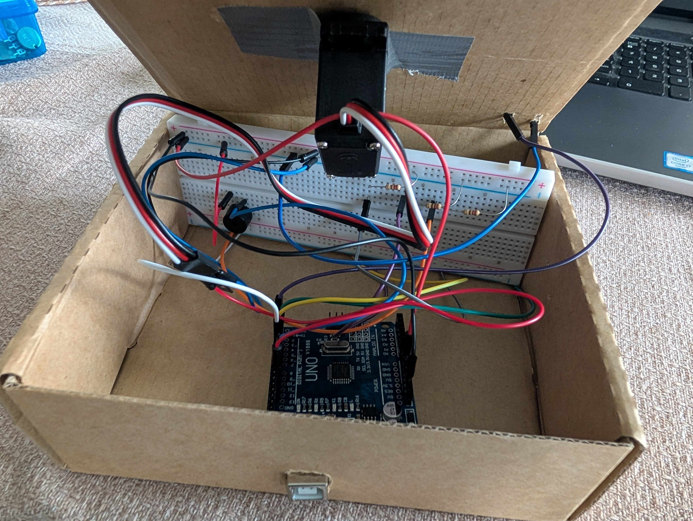
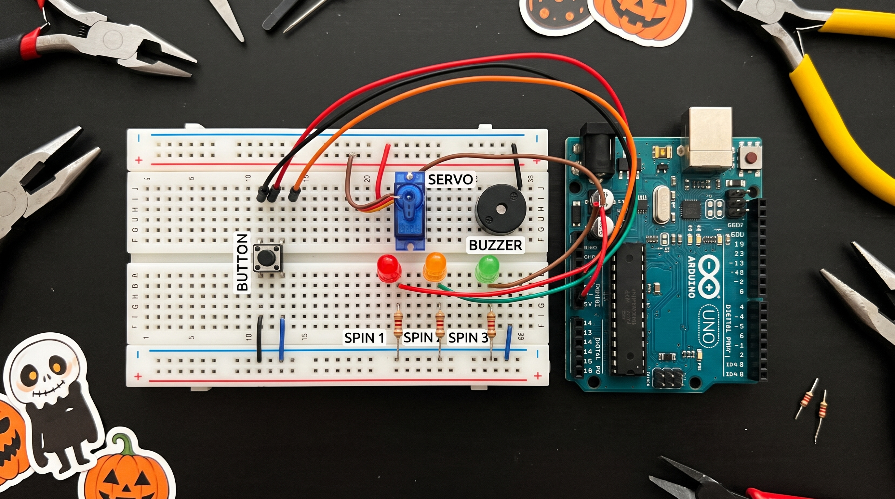
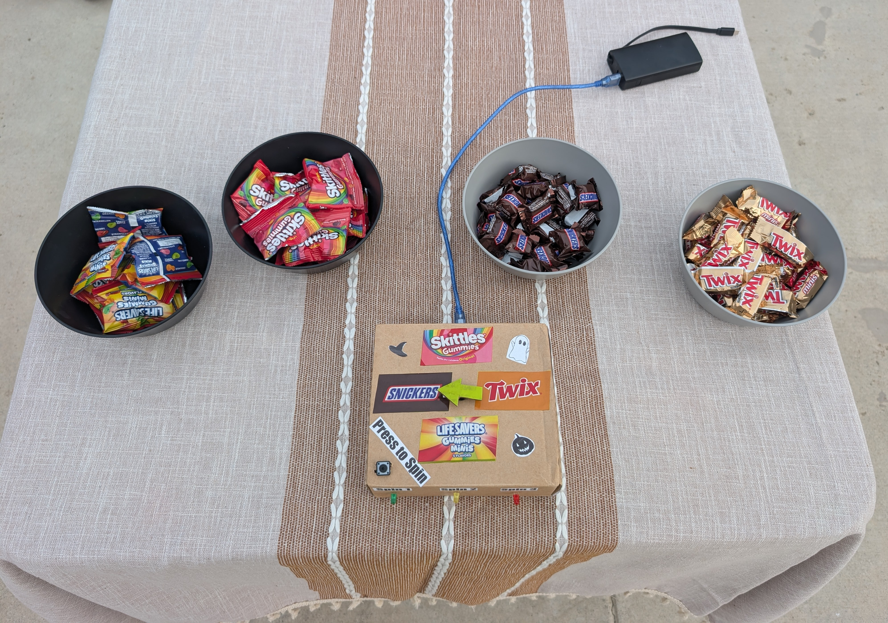
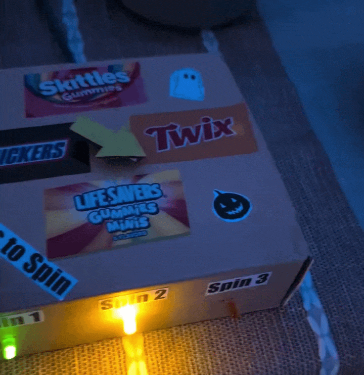

# 🎃 Wheel of Fate: Halloween Candy Roulette

Bring the thrill of an arcade carnival to your Halloween setup!

Press the mysterious button to spin the motorized pointer --- will your fate land on **Snickers**, **Skittles**, **Twix**, or **Life Savers Gummies**?

This Arduino-powered project uses a **360° continuous rotation servo** to spin the wheel with retro arcade sound effects and tracks 3 consecutive turns per player using indicator LEDs.

------------------------------------------------------------------------

## 🧩 Features

* Randomized 4-quadrant candy selector
* 360° motorized pointer with suspenseful coast-down deceleration
* Synchronized arcade clicking sounds and victory fanfares via piezo buzzer
* Sequential LED turn tracking (3 spins per player)
* Automatic servo detachment to eliminate motor creep and jitter during idle

------------------------------------------------------------------------

## ⚙️ Components Needed

Component                       Quantity   Notes
------------------------------- ---------- --------------------------
Arduino Uno (or compatible)     1          Microcontroller
Servo Motor (continuous 360°)   1          Spins the pointer arrow
Push Button (momentary)         1          Player spin trigger
LEDs (5mm)                      3          Tracks Turn 1, 2, and 3
220 Ω resistors                 3          Current limiting for LEDs
Piezo Buzzer (passive)          1          Arcade clicks & fanfares
Jumper Wires                    several

Breadboard                      1          For building circuit
Foam Board / Cardboard          1          Wheel face dial and pointer
(Optional) 470 µF capacitor     1          To stabilize servo power

------------------------------------------------------------------------

## 🔌 Circuit Diagram

**Notes:** - Each LED must have its own 220 Ω resistor. - All LED cathodes (short legs) connect to a common GND rail. - Push button connects between Pin 2 and GND (uses Arduino internal `INPUT_PULLUP`). - Servo signal connects to Pin 9, with 5V and GND directly tied to the power rails.

------------------------------------------------------------------------

## 💾 How It Works

* Player presses the arcade push button to begin a round.
* The continuous servo spins the pointer with rapid, tension-building buzzer clicks.
* The pointer decelerates and stops squarely at one of 4 candy sectors (Snickers, Skittles, Twix, or Life Savers Gummies).
* A celebratory chime plays, and the player takes one piece of the landed treat.
* Each player gets **3 spins total**, accumulating 3 candies before the game plays a grand finale fanfare and resets for the next challenger 👻.

------------------------------------------------------------------------

## 🧠 Credits

* Project by **Raoul Mendanha**
* Built with Arduino IDE

------------------------------------------------------------------------

## 📸 Images & Video

        
  ------------------------------ ------------------------------

------------------------------------------------------------------------

## 🪦 License

This project is licensed under the [MIT License](LICENSE).\
Feel free to share, remix, or build your own haunted contraptions ---
just keep the credits!

------------------------------------------------------------------------

🎃 Happy Haunting and Happy Coding!
